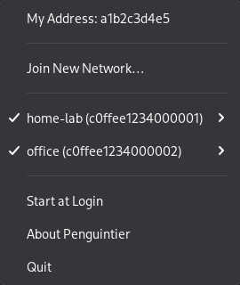
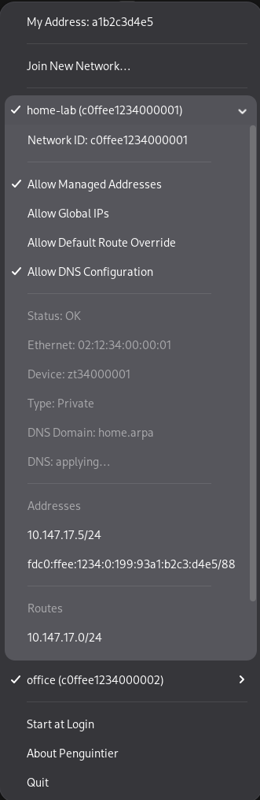

<p align="center">
  
</p>

<h1 align="center">Penguintier</h1>

<p align="center">
  A <a href="https://www.zerotier.com/">ZeroTier</a> tray app for Linux, with the same menu as the official app on macOS and Windows.<br>
  It also makes ZeroTier's DNS settings work on Linux.
</p>

> [!NOTE]
> Penguintier is an unofficial app and is not affiliated with ZeroTier, Inc.
> It works with the ZeroTier service you already have installed and doesn't
> replace it.

<div align="center">
<table>
  <tr>
    <td align="center" valign="top">
      <a href="docs/screenshots/tray-menu.png"></a>
    </td>
    <td align="center" valign="top">
      <a href="docs/screenshots/tray-network.png"></a>
    </td>
  </tr>
  <tr>
    <td align="center"><sub>The tray menu</sub></td>
    <td align="center"><sub>A network's submenu</sub></td>
  </tr>
</table>
</div>

## What it does

Penguintier puts your ZeroTier node in the system tray. From its menu you
can:

- see your node address and copy it with a click
- join a network by its 16-digit ID, and leave it again
- disconnect from a network and reconnect later with the same settings, or
  forget it
- turn Allow Managed Addresses, Allow Global IPs, Allow Default Route
  Override and Allow DNS Configuration on or off for each network
- check a network's status, interface, type, DNS domain, addresses and
  routes, and copy any address
- log in to networks that use SSO, with a notification when a login is due
- have it start when you log in

The icon changes when ZeroTier is offline or a network needs attention.
When something isn't working, `penguintier doctor` tells you what is wrong
and how to fix it.

On Linux, ZeroTier ignores a network's DNS settings. Penguintier fills that
gap through systemd-resolved ([how it works](#dns-for-zerotier-networks)).

It runs on Ubuntu 24.04 and later, Debian 12 and later, current Fedora and
Linux Mint 22 and later, on x86_64. The icon shows up on any desktop whose
panel supports StatusNotifierItem (AppIndicator) icons, so
[check your desktop](#3-check-your-desktops-tray) before installing.

## Install

### 1. Install ZeroTier

Penguintier needs the ZeroTier service (`zerotier-one`). Get it from
<https://www.zerotier.com/download/>. On Linux that usually means ZeroTier's
install script, which adds their package repository:

```bash
curl -s https://install.zerotier.com | sudo bash
```

Afterwards, `sudo zerotier-cli info` should print
`200 info <your address> <version> ONLINE`.

### 2. Install Penguintier

Download the package for your distribution from the
[latest release](https://github.com/rasikhq/penguintier/releases/latest)
and install it with your package manager, which also pulls in everything it
needs.

On Debian, Ubuntu, Linux Mint and Pop!_OS:

```bash
sudo apt install ./penguintier_0.1.0_amd64.deb
```

On Fedora:

```bash
sudo dnf install ./penguintier-0.1.0-1.x86_64.rpm
```

To verify the download, put `SHA256SUMS` from the same release next to it
and run `sha256sum --check --ignore-missing SHA256SUMS`.

Then start Penguintier from your app menu. Updates install the same way.

### 3. Check your desktop's tray

Most desktops show the icon without any setup:

- KDE Plasma, Cinnamon (Linux Mint) and COSMIC (Pop!_OS) work out of the
  box.
- Xfce works with its default panel. If you removed the tray from it, add
  the "Status Tray Plugin" back.
- sway, Hyprland and niri work with waybar, as long as `tray` is in your
  waybar modules. The default config has it.
- MATE, Budgie and LXQt need a tray applet on the panel.
- GNOME needs an extension (see below).

#### GNOME

GNOME only shows tray icons with the "AppIndicator and KStatusNotifierItem
Support" extension. Ubuntu ships it installed and turned on, so Ubuntu users
can skip this part. On other distributions, install the extension, log out
and back in (GNOME on Wayland only picks up new extensions at login), and
then turn it on:

| Distribution | Install | Turn on |
|---|---|---|
| Debian | `sudo apt install gnome-shell-extension-appindicator` | `gnome-extensions enable ubuntu-appindicators@ubuntu.com` |
| Fedora | `sudo dnf install gnome-shell-extension-appindicator` | `gnome-extensions enable appindicatorsupport@rgcjonas.gmail.com` |
| Others | from [extensions.gnome.org](https://extensions.gnome.org/extension/615/) | `gnome-extensions enable appindicatorsupport@rgcjonas.gmail.com` |

The Debian package and the extensions.gnome.org version use different IDs,
which is why the commands differ. The Extensions app can turn it on as well.

If Penguintier can't find a tray when it starts, it shows a notification
with these steps for your desktop.

Two things work differently on GNOME. A left click opens the menu after a
short pause, because GNOME first waits to see whether it's a double click.
And GNOME doesn't show tray tooltips.

## First run

The first time you start Penguintier, your desktop asks for your password
with this message:

> Penguintier needs to read the ZeroTier service's API token so it can show
> and change your ZeroTier networks.

ZeroTier only accepts commands from programs that know its API token, and
only root can read the token file, `/var/lib/zerotier-one/authtoken.secret`.
Once you enter your password, Penguintier keeps a copy of the token in
`~/.zeroTierOneAuthToken` that only you can read, so it won't need to ask
again. `zerotier-cli` uses the same file, which means it works without
`sudo` from then on.

If you close the prompt instead, nothing changes, and the menu offers
"Authorize Penguintier…" for later. After the first successful start,
Penguintier also turns on Start at Login. Uncheck it in the menu if you
don't want that.

### What the token copy means for security

Anyone with the token has full control of ZeroTier on this computer. They
can join and leave networks and change their settings, including Allow
Default Route Override, which can send all of your traffic through a
network.

With the copy in your home folder, any program running under your account
has that control too, without a password prompt. Other users on the
computer can't read it. The file is mode 0600, and Penguintier refuses to
use it if that ever changes.

`penguintier deauthorize` deletes the copy. A Penguintier that is already
running keeps working until you quit it, and the next start asks for your
password again.

The DNS service never uses your copy. systemd hands it a private copy of
the token when it starts.

## DNS for ZeroTier networks

A ZeroTier network can carry DNS settings: a domain such as
`office.example`, and the DNS servers that answer for it. The network's
admin sets them in ZeroTier Central or on their own controller.

### Why "Allow DNS Configuration" does nothing on Linux

On macOS and Windows, checking Allow DNS Configuration makes ZeroTier send
lookups for that domain to the network's DNS servers. On Linux the ZeroTier
service stores the setting but never applies it, because that part was
never implemented there
([ZeroTierOne#2492](https://github.com/zerotier/ZeroTierOne/issues/2492)).
With the box checked, `fileserver.office.example` still doesn't resolve.

### How Penguintier does it

The package installs a small system service, `penguintier-dnsd`, which runs
as its own unprivileged user. Every 5 seconds it looks at your networks. For
each one that has Allow DNS Configuration on, is connected and has a DNS
domain and servers, it tells systemd-resolved to send lookups for that
domain to those servers, on that network's interface only.

The domain is set as routing-only (`~office.example`), and the network never
becomes your default DNS. Only names under the network's domain go to its
servers. Everything else resolves exactly as before.

The service only manages settings it made itself. If another tool has
already put DNS settings on a ZeroTier interface, the service leaves that
interface alone, and it will do the same for ZeroTier if ZeroTier ever
handles DNS itself on Linux. Turning the option off, leaving the network or
stopping the service removes the settings again. If systemd-resolved isn't
running yet, the service waits and applies the settings as soon as it
starts.

Each network's submenu has a DNS row that shows where things stand:

| Row | Meaning |
|---|---|
| DNS: applied | Lookups under the network's domain go to its DNS servers. |
| DNS: not requested (Allow DNS is off) | Check Allow DNS Configuration to use the network's DNS. |
| DNS: network has no DNS | The network's admin hasn't set a DNS domain and servers. |
| DNS: waiting for systemd-resolved | This computer doesn't run systemd-resolved. See the next section. |
| DNS: daemon not running | `penguintier-dnsd` is stopped. Run `penguintier doctor` to see why. |
| DNS: link managed by systemd-networkd | systemd-networkd manages this interface, and resolved won't take DNS settings for it from other programs. |
| DNS: set by another program | Another tool set DNS on this interface, so Penguintier stays out of the way. |

### Enable DNS support… (Debian)

Ubuntu, Linux Mint, Pop!_OS and Fedora already run systemd-resolved. Debian
doesn't. There, NetworkManager writes `/etc/resolv.conf` itself, and the DNS
row says "waiting for systemd-resolved". In that case the menu offers
Enable DNS support…, which switches the computer over to systemd-resolved in
five steps:

1. It checks that your setup is one it knows how to switch safely: Debian
   or a derivative, with NetworkManager managing `/etc/resolv.conf`, as on a
   normal desktop install. If not, it explains why and changes nothing.
2. It asks whether to go ahead, then asks for your password once.
3. It backs up `/etc/resolv.conf`, `/etc/nsswitch.conf` and
   `/etc/systemd/resolved.conf` (if there is one) to
   `/var/lib/penguintier/dns-backup/`.
4. It installs the `systemd-resolved` package and nothing else.
5. It checks that names still resolve. If they don't, it undoes everything
   by itself and restores the backed-up files.

To switch back later, run:

```bash
pkexec /usr/libexec/penguintier/penguintier-dns-helper undo
```

This removes systemd-resolved and restores the backed-up files.
`penguintier doctor` shows whether the switch is on and prints the same
command. The command ships with Penguintier, so if you want your old DNS
setup back, undo the switch before you uninstall.

## Troubleshooting

Start with the doctor. It checks everything Penguintier depends on and tells
you how to fix whatever is wrong:

```bash
penguintier doctor
```

```text
Penguintier doctor

  info  Penguintier       0.1.0
  ok    ZeroTier service  ZeroTier 1.16.2, running at http://127.0.0.1:9993
  ok    API token         /home/you/.zeroTierOneAuthToken (yours, mode 0600)
  ok    API access        the token works (node a1b2c3d4e5, online)
  ok    Tray host         gnome-shell shows tray icons on GNOME (wayland)
  ok    Notifications     gnome-shell 48.7
  ok    Clipboard         wl-copy, xclip
  ok    Authorizing       pkexec, agent gnome-shell, helper /usr/libexec/penguintier/penguintier-token-helper
  ok    systemd-resolved  running
  ok    DNS daemon        penguintier-dnsd.service is active
  ok    Network DNS       1 applied

No problems found.
```

Some common problems:

| Problem | What to do |
|---|---|
| No icon | On GNOME, see [GNOME](#gnome). On other desktops, make sure the panel has a tray. `penguintier doctor` shows which desktop it detected. |
| "Waiting for ZeroTier system service…" | The ZeroTier service isn't running. Start it with `sudo systemctl enable --now zerotier-one`. |
| No password prompt | This happens on sway and other setups without a polkit agent. `penguintier doctor` prints a command that makes the token copy by hand. |
| Copying does nothing | Install `wl-clipboard` (Wayland) or `xclip` (X11). Without either, Penguintier shows the text in a notification. |

The tray logs to `journalctl --user -t penguintier`, and the DNS service to
`journalctl -u penguintier-dnsd`.

When you [report a bug](https://github.com/rasikhq/penguintier/issues),
please attach the output of `penguintier doctor --json`. It contains your
ZeroTier address and network IDs, so replace them if you'd rather not share
them.

## Command line

```text
penguintier                     start the tray
penguintier doctor [--json]     check the setup and print a report
penguintier deauthorize [--yes] delete the token copy
penguintier --version           print the version
```

Run from a terminal, `penguintier` moves itself to the background and gives
you the terminal back. Add `--foreground` to keep it there with its log.
`man penguintier` covers the rest, including environment variables and
files.

## Uninstall

```bash
penguintier deauthorize          # delete the token copy (optional)
sudo apt remove penguintier      # Debian, Ubuntu, Mint
sudo dnf remove penguintier      # Fedora
```

Quit Penguintier from its menu first, since removing the package doesn't
stop a tray that is already running. Removing it does stop the DNS
service, which takes its DNS settings with it. If you used Enable DNS support… and want your old DNS setup back,
[undo it](#enable-dns-support-debian) before uninstalling.

Your settings stay behind in `~/.config/penguintier/`, along with the Start
at Login entry in `~/.config/autostart/io.github.rasikhq.Penguintier.desktop`.
Your desktop ignores that entry once Penguintier is gone, but you can delete
both for a clean slate.

## Build from source

You need Go, [bun](https://bun.sh/) 1.3, make, and the development packages
for GTK 3 and WebKitGTK 4.1. Go downloads the exact version pinned in
`go.mod` by itself.

```bash
sudo apt install golang make libgtk-3-dev libwebkit2gtk-4.1-dev   # Debian, Ubuntu
sudo dnf install golang make gtk3-devel webkit2gtk4.1-devel       # Fedora
```

If `go env GOTOOLCHAIN` prints `local`, run `go env -w GOTOOLCHAIN=auto`
once. Then:

```bash
make tools                       # golangci-lint, wails, goreleaser into ~/go/bin
make lint test build ui-build    # check and build everything
make run                         # run the tray from source
make package                     # .deb and .rpm into dist/
```

## Contributing

Bug reports, test results from more desktops and pull requests are all
welcome. Before writing code, have a look at these:

- [CLAUDE.md](CLAUDE.md) holds the project rules: Go style, contracts
  and commit conventions. Penguintier is built with the help of Claude,
  Anthropic's AI assistant, which works from the same file.
- [docs/architecture.md](docs/architecture.md) explains how the parts fit
  together and the contracts between them.
- [docs/testing.md](docs/testing.md) describes how each part is tested. It
  includes a fake ZeroTier API (`make tray-mock`) for working on the tray
  without touching your real networks.

The Go code is kept plain and well commented, so people who are new to Go
can read and review it.

Penguintier is written from scratch, based on ZeroTier's documented API and
the official app's observed behavior. Please don't copy code from ZeroTier's
own desktop app, which is under a different license.

## License

Penguintier is released under the [MIT license](LICENSE). The packages also
install `/usr/share/doc/penguintier/THIRD_PARTY_LICENSES`, which holds the
licenses of the libraries compiled into it.

Penguintier is an unofficial app and is not affiliated with ZeroTier, Inc.
ZeroTier is a trademark of ZeroTier, Inc.
